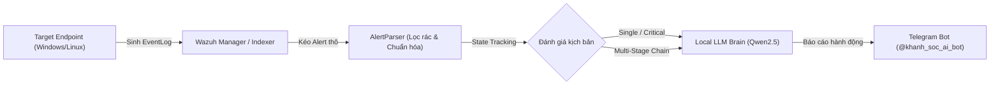

# 🛡️ ARGUS-SOC: Autonomous Local AI Orchestrator for Wazuh SIEM

**ARGUS-SOC** là hệ thống **AI SOC Analyst tự hành (Autonomous SOC Orchestrator)** chạy hoàn toàn On-Premise. Dự án tích hợp trực tiếp vào hệ thống SIEM mã nguồn mở hàng đầu **Wazuh**, tự động thu thập các cảnh báo bảo mật thời gian thực, bóc tách dữ liệu chuyên sâu, xâu chuỗi các bước tấn công thành chiến dịch (Attack Correlation), và sử dụng **Trí tuệ nhân tạo cục bộ (Local LLM - Ollama Qwen2.5)** để giải mã ý đồ của hacker, dự đoán bước đi tiếp theo và đề xuất phương án ứng cứu khẩn cấp qua **Telegram**.

---

## 🏗️ Kiến Trúc Hệ Thống & Luồng Dữ Liệu

Hệ thống được thiết kế theo mô hình phân tán thực chiến, mô phỏng đúng hạ tầng mạng của các trung tâm điều hành an ninh mạng (SOC) doanh nghiệp:

### 📊 Sơ Đồ Luồng Hoạt Động & Kiến Trúc Tổng Thể (Workflow Architecture)
#### 1. Sơ đồ Kiến trúc Nền tảng (Baseline Architecture)


#### 🔍 Phân Tích Chuyên Sâu Các Phân Vùng Trong Sơ Đồ:

1. **MÁY A – SOC SERVER (Ubuntu Server - `<SOC_SERVER_IP>`):**
   * **Wazuh Core:**
     * *Wazuh Manager (Port 55000):* Quản lý trạng thái và chính sách bảo mật cho toàn bộ Agents.
     * *Wazuh Indexer / OpenSearch (Port 9200):* Lưu trữ, đánh chỉ mục và truy vấn toàn bộ security alerts.
     * *Wazuh Dashboard (Port 443):* Giao diện trực quan hóa dữ liệu và điều tra sự cố.
   * **Local AI Engine (Ollama - `<AI_SERVER_IP>:11434`):** Chạy mô hình ngôn ngữ lớn `qwen2.5:3b` chuyên dụng phân tích mã độc hoàn toàn trong mạng LAN nội bộ, bảo mật tuyệt đối không gửi dữ liệu ra ngoài Internet.
   * **Python Orchestrator (Trung tâm điều phối):**
     * *Collectors:* Kéo dữ liệu tự động từ Wazuh Indexer & API theo chu kỳ 3 giây.
     * *Processors:* Bóc tách sâu Windows/Linux events, lọc sạch 85% log rác, duy trì bộ nhớ trượt 5 phút xâu chuỗi tấn công.
     * *AI Analysis & Sanitization:* Đưa prompt có cấu trúc sang AI và chuẩn hóa phản hồi.
     * *Notification:* Gửi bản tin Markdown tức thì về điện thoại qua Telegram Bot.
   * **Database (SQLite):** Lưu vết các sự cố, lịch sử phân tích và trạng thái xử lý của từng cảnh báo.
   * **Telegram Bot Notifier (`@khanh_soc_ai_bot`):** Bắn báo động đỏ trực tiếp tới điện thoại/laptop của SOC Analyst.

2. **MÁY B – ENDPOINT / ATTACK LAB (Windows 10 Pro - `<TARGET_ENDPOINT_IP>`):**
   * **Wazuh Agent:** Thu thập và đẩy toàn bộ sự kiện hệ thống về Wazuh Manager theo thời gian thực.
   * **Microsoft Sysmon & Windows Event Logs:** Ghi nhận chuyên sâu các sự kiện: tạo tiến trình (Process Creation), kết nối mạng (Network Connections), thao tác tệp tin (File Events), và các nhật ký Security/System/Application.
   * **Attack Simulation (Môi trường giả lập tấn công):** Nơi thực thi các công cụ kiểm thử xâm nhập thực tế: Atomic Red Team, PowerShell Exploitation, Nmap, tạo tài khoản ngầm, leo quyền Admin, xóa log.

3. **QUY TRÌNH 6 BƯỚC CỦA AI-SOC WORKFLOW:**
   * **Bước 1 (Event Collection):** Kéo các alert mới phát sinh kèm bằng chứng (evidence) từ Wazuh Indexer (Port 9200).
   * **Bước 2 (Normalization & Deduplication):** Chuẩn hóa cấu trúc dữ liệu, khử trùng lặp và loại bỏ các log ồn ào vô hại (Noise filter).
   * **Bước 3 (Correlation & Context):** Kết hợp nhiều alert liên tiếp trên cùng một máy mục tiêu trong cửa sổ 5 phút để xây dựng ngữ cảnh chiến dịch (Incident Context).
   * **Bước 4 (AI Analysis - Ollama + Qwen):** Đánh giá True/False Positive, giải mã ý đồ của kẻ xâm nhập, gán nhãn ma trận MITRE ATT&CK và đề xuất phương án ứng cứu.
   * **Bước 5 (Validation & Risk Assessment):** Kiểm định tính hợp lệ của phân tích, đánh giá mức độ nghiêm trọng (Severity) và độ tin cậy (Confidence).
   * **Bước 6 (Incident Storage & Notification):** Lưu vết sự cố vào cơ sở dữ liệu và phát cảnh báo hành động tức thì tới Telegram.

> **🎯 Mục tiêu cốt lõi:** *"Phát hiện sớm – Phân tích chính xác – Cảnh báo kịp thời"*.

---

## 📁 Cấu Trúc Thư Mục Dự Án

```
AI_Prompt/
│
├── configure.env                   # File cấu hình IP, Port, Token và Password bảo mật
├── README.md                       # Tài liệu kiến trúc và bằng chứng thực nghiệm của dự án
│
├── image/                          # Thư mục tài nguyên sơ đồ kiến trúc & ảnh chụp thực nghiệm
│   ├── AI-SOC Wazuh Workflow Architecture.png # Sơ đồ luồng dữ liệu và kiến trúc phân tán tổng thể
│   ├── Screenshot 2026-11-12 182744.png      # Thực nghiệm tạo user trên Windows & Wazuh Event Log
│   ├── Screenshot 2026-11-12 182826.png      # Bảng điều khiển Orchestrator nhận diện Multi-Stage Attack
│   ├── Screenshot 2026-11-12 182759.png      # Báo cáo chuỗi tấn công tức thì gửi về Telegram Bot
│   ├── Screenshot 2026-11-12 182920.png      # Lệnh xóa tài khoản / dọn dấu vết trên Windows CMD
│   └── Screenshot 2026-11-12 182925.png      # Cảnh báo Telegram khi hacker xóa tài khoản phi tang
│
└── orchestrator/                   # Mã nguồn chính của bộ điều phối Orchestrator
    ├── main.py                     # Tiến trình điều phối trung tâm (Vòng lặp canh gác 24/7)
    │
    ├── ai/
    │   └── ollama_client.py        # Module kết nối LAN tới máy AI (Fallback & Prompt Sanitization)
    │
    ├── collectors/
    │   ├── wazuh_api_client.py     # Module giao tiếp Wazuh Manager API (55000 - Quản lý cấu hình)
    │   └── wazuh_indexer_client.py # Module kéo Alert từ Wazuh Indexer OpenSearch (Port 9200)
    │
    ├── config/
    │   ├── system_prompt.txt       # System Prompt quy định nhân cách AI và mẫu báo cáo chuẩn SOC
    │   └── rules.yaml              # Cấu hình ngưỡng cảnh báo, lệnh cấm, rule bỏ qua (Noise filter)
    │
    ├── notifiers/
    │   └── telegram_notifier.py    # Module gửi tin nhắn Markdown trực tiếp về Telegram Bot
    │
    └── processors/
        ├── alert_parser.py         # Bộ bóc tách sâu Windows/Linux log, cắt giảm 85% token rác
        └── state_tracker.py        # Bộ nhớ trượt (Sliding Window) xâu chuỗi các bước tấn công
```

---

## ⚙️ Cơ Chế Hoạt Động Chi Tiết (End-to-End Workflow)

Quá trình từ lúc hacker thực hiện hành vi xâm nhập trên máy nạn nhân cho đến khi báo cáo xuất hiện trên điện thoại của quản trị viên diễn ra hoàn toàn tự động qua 5 giai đoạn:



### 1. Thu thập cảnh báo theo thời gian thực (Real-time Ingestion)
* Máy tính mục tiêu (`windows_1`) cài đặt Wazuh Agent, ghi nhận mọi hành vi hệ thống (tạo tài khoản, đổi nhóm quyền, cài đặt service, logon RDP/SMB, xóa log).
* Wazuh Manager phân tích log theo Ruleset và nạp vào OpenSearch Indexer (Port 9200).
* `WazuhIndexerClient` chạy vòng lặp ngầm (polling mỗi 3 giây) để bắt kịp thời các sự kiện vừa phát sinh mà không làm trễ tiến trình điều tra.

### 2. Bóc tách sâu & Tinh lọc dữ liệu (Deep Parsing & Token Optimization)
* Dữ liệu JSON gốc của Wazuh rất cồng kềnh (thường từ 200–500 dòng chứa nhiều metadata dư thừa).
* `AlertParser` loại bỏ **85% dữ liệu rác**, trích xuất chính xác các trường trọng yếu:
  * **Kẻ thực thi (Actor User):** Ai đang gõ lệnh hoặc thao tác tài khoản?
  * **Đối tượng bị tác động (Target User/Group):** Tài khoản nào bị tạo mới? User nào bị gán vào nhóm `Administrators`?
  * **Tuyến mạng Nguồn ➔ Đích:** Địa chỉ IP kẻ tấn công (kèm Port) đến địa chỉ IP nạn nhân.
  * **Giao thức & Phương thức truy cập:** Phân biệt rõ đăng nhập tại chỗ (`Local Console`), từ xa (`RDP - Port 3389`), hay qua chia sẻ tệp (`SMB - Port 445`).
  * **Hành vi cụ thể:** Diễn giải rõ ràng hành động thực tế (Ví dụ: `User [khanh] đã THÊM tài khoản vào nhóm đặc quyền [Administrators]`) thay vì chỉ hiện tên mô tả chung chung.

### 3. Tương quan chuỗi sự kiện bằng bộ nhớ trượt (State Tracking & Correlation)
* Kẻ tấn công hiếm khi chỉ thực hiện một hành động đơn lẻ; chúng thường đi theo chuỗi: *Thăm dò ➔ Tạo tài khoản ➔ Leo quyền Admin ➔ Đăng nhập chiếm quyền ➔ Xóa log*.
* `AttackStateTracker` duy trì một cửa sổ thời gian trượt (**5-minute Sliding Window**):
  * **Single Alert:** Cảnh báo đơn lẻ có rủi ro trung bình.
  * **Critical Single Alert:** Báo động đỏ khẩn cấp khi phát hiện lệnh phá hoại nguy hiểm (như xóa log bằng `wevtutil`, lệnh dump mật khẩu, hoặc can thiệp nhóm quản trị).
  * **Multi-Stage Attack:** Khi phát hiện từ 2 sự kiện đáng ngờ trở lên trên cùng một máy mục tiêu trong vòng 5 phút, hệ thống tự động gom toàn bộ lại thành một **chuỗi tấn công liên hoàn (Attack Timeline)**.

### 4. Suy luận bảo mật bằng Local AI (Air-gapped LLM Reasoning)
* Dữ liệu sau khi tinh lọc được gửi nội bộ qua cổng LAN `11434` sang máy chủ Ollama chạy mô hình `qwen2.5:3b`.
* AI phân tích theo kỹ thuật chuyên môn SOC:
  * Ánh xạ hành vi vào ma trận **MITRE ATT&CK** (Persistence, Privilege Escalation, Defense Evasion,...).
  * **Dự đoán bước đi tiếp theo của hacker:** Kẻ tấn công vừa làm xong bước này thì sắp tới sẽ làm gì? (Ví dụ: Vừa tạo xong user Admin ➔ Dự đoán sắp RDP vào máy để cài backdoor hoặc tắt Antivirus).
  * **Đề xuất lệnh ứng cứu khẩn cấp:** Đưa ra câu lệnh CMD/PowerShell cụ thể để người trực ca có thể copy thi hành ngay lập tức.

### 5. Phát cảnh báo hành động trực tiếp (Actionable Dispatching)
* Báo cáo được biên soạn ngắn gọn theo chuẩn Markdown di động, gửi tức thì qua Telegram Bot tới người quản trị trong vòng **dưới 2 giây**, giúp đội ngũ bảo mật ra quyết định ngay trên điện thoại mà không cần phải mở máy tính tra cứu SIEM.

---

## 📸 Kết Quả Thực Nghiệm & Bằng Chứng Thực Chiến (Live Demonstration)

Dưới đây là bằng chứng thực tế thu được trong quá trình kiểm thử xâm nhập thực nghiệm giữa máy tấn công (`windows_1`), hệ thống SIEM Wazuh, bộ điều phối ARGUS-SOC và bot Telegram:

---

### 🧪 Kịch bản 1: Chuỗi tấn công tạo tài khoản ẩn & Leo thang đặc quyền (Multi-Stage Attack)

#### Bước 1: Kẻ tấn công thực thi lệnh trên máy Windows mục tiêu & Wazuh ghi nhận log


* **Hành vi thực thi trên CMD (Admin):**
  ```cmd
  net user khanh_de190997 khanh123 /add
  ```
* **Phân tích nhật ký Wazuh Dashboard:**
  Ngay lập tức, hệ thống Wazuh SIEM ghi nhận đồng thời 5 sự kiện bảo mật theo thời gian thực:
  * `Rule 60109 (Level 8)`: *User account enabled or created* (Event ID 4720).
  * `Rule 60110 (Level 8)`: *User account changed* (Event ID 4738).
  * `Rule 60160 (Level 5)`: *Domain Users Group Changed* (Event ID 4728).
  * `Rule 60170 (Level 5)`: *Users Group Changed* (Event ID 4732).

---

#### Bước 2: ARGUS Orchestrator bóc tách dữ liệu, nhận diện chuỗi tấn công và gửi AI phân tích


* **Phân tích cơ chế xử lý của Orchestrator:**
  * Bóc tách chính xác: Người thực hiện `User [khanh]`, tài khoản đích `[khanh_de190997]`, tuyến mạng `Local Console ➔ windows_1 (<TARGET_ENDPOINT_IP>)`.
  * Bộ nhớ trượt `StateTracker` gom 5 sự kiện phát sinh liên tiếp và kích hoạt kịch bản **`[MULTI_STAGE_ATTACK]`**.
  * Dữ liệu context được gửi ngay lập tức sang máy chủ AI `<AI_SERVER_IP>` (Qwen2.5-3B) để tổng hợp thành bản tin tác chiến hoàn chỉnh.

---

#### Bước 3: Báo cáo chuỗi tấn công thời gian thực gửi về Telegram Bot


* **Nội dung bản tin tác chiến nhận được qua Telegram:**
  * **Mục tiêu:** `Local Console (khanh) ➔ windows_1 (<TARGET_ENDPOINT_IP>)`.
  * **Timeline các bước của hacker:**
    1. `Rule 60160 (Level 5)` ➔ Thêm thành viên vào Security Group None bởi User khanh | MITRE: `T1484`.
    2. `Rule 60109 (Level 8)` ➔ Tạo tài khoản mới: `khanh_de190997` bởi User khanh | MITRE: `T1098`.
    3. `Rule 60109 (Level 8)` ➔ User account was enabled (Actor: khanh, Target: khanh_de190997) | MITRE: `T1098`.
    4. `Rule 60110 (Level 8)` ➔ Thay đổi thuộc tính tài khoản: `[khanh_de190997]` bởi User khanh | MITRE: `T1098`.
    5. `Rule 60170 (Level 5)` ➔ THÊM tài khoản vào nhóm đặc quyền Users bởi User khanh | MITRE: `T1484`.
  * **Ý đồ tấn công:** Kẻ tấn công đang phối hợp nhiều kỹ thuật leo thang đặc quyền để chiếm quyền điều khiển hệ thống.
  * **Phương án ngăn chặn khẩn cấp:**
    * *Xử lý tức thì:* `netsh advfirewall set allprofiles state on` & cô lập ngay host nạn nhân.
    * *Phòng ngừa lây lan:* Thu hồi các tài khoản vừa được tạo, quét các tiến trình ngầm và kiểm tra toàn bộ kết nối mạng outbound.

---

### 🧪 Kịch bản 2: Dọn dẹp dấu vết / Xóa tài khoản phi tang (Defense Evasion & Account Removal)

#### Bước 1: Kẻ tấn công xóa tài khoản để che giấu hành vi


* **Hành vi thực thi trên CMD (Admin):**
  ```cmd
  net user khanh_de190997 /delete
  ```
  *(Lệnh được hoàn tất thành công nhằm phi tang tài khoản sau khi xâm nhập).*

---

#### Bước 2: ARGUS-SOC lập tức phát hiện hành vi xóa tài khoản và bắn cảnh báo về Telegram


* **Phân tích cảnh báo từ Telegram Bot:**
  * **Timeline phát hiện:**
    1. `Rule 60170 (Level 5)` ➔ GỠ tài khoản khỏi nhóm đặc quyền Users bởi User khanh | MITRE: `T1484`.
    2. `Rule 60160 (Level 5)` ➔ Gỡ thành viên khỏi Security Group None bởi User khanh | MITRE: `T1484`.
    3. `Rule 60111 (Level 8)` ➔ **Xóa tài khoản: `khanh_de190997` bởi User khanh** | MITRE: `T1098`, `T1531`.
  * **Đánh giá nghiệp vụ:** Hệ thống nhận diện hành vi xóa tài khoản bất thường, tự động đối chiếu mã MITRE `T1531` (*Account Access Removal*) và kích hoạt khuyến nghị rà soát toàn bộ kết nối outbound xem dữ liệu có bị đánh cắp trước khi tài khoản bị xóa hay không.

---

## 🧠 Bản Chất Khi Kết Hợp Thêm AI Vào SOC Là Gì?

Trong các hệ thống SOC truyền thống, SIEM chỉ đóng vai trò là một **bộ lưu trữ và so khớp tĩnh (Rule-based Pattern Matching)**:
> *"Nếu thấy Event ID 4732 thì phát sinh cảnh báo Level 12."*

Cách làm này khiến con người phải tự đọc từng dòng log thô, tự xâu chuỗi và tự suy luận xem chuyện gì đang xảy ra.

### Sự khác biệt cốt lõi khi có thêm AI (ARGUS-SOC):
1. **Khả năng hiểu ngữ cảnh (Contextual Intelligence):**
   Thay vì chỉ thông báo *"Nhóm Administrators bị đổi"*, AI đọc toàn bộ chuỗi ngữ cảnh để hiểu: *Ai làm? Thao tác đó diễn ra sau hành động nào? Đây là thao tác bảo trì hay kẻ tấn công đang chuẩn bị chiếm quyền kiểm soát máy?*
2. **Năng lực dự đoán chủ động (Predictive SOC vs. Reactive SOC):**
   SIEM truyền thống chỉ báo cáo những gì **đã xảy ra trong quá khứ**. Khi kết hợp AI, hệ thống chuyển sang trạng thái **chủ động đón đầu**: dự đoán trước bước đi kế tiếp của kẻ xâm nhập dựa trên khung chiến thuật MITRE ATT&CK.
3. **Chuyển đổi dữ liệu thô thành hành động (From Raw Logs to Actionable Remediation):**
   AI không để quản trị viên phải tự nghĩ cách đối phó; nó đóng vai trò như một **chuyên viên phân tích SOC L1/L2 dày dạn kinh nghiệm**, đưa ra ngay câu lệnh khẩn cấp (như lệnh cô lập Firewall, lệnh vô hiệu hóa tài khoản bị lợi dụng) để ngăn chặn mã độc kịp thời.

---

## ⚔️ So Sánh Trực Diện: SIEM Truyền Thống vs. ARGUS-SOC

| Tiêu chí | SIEM Truyền Thống (Wazuh / Splunk đơn thuần) | ARGUS-SOC (Wazuh kết hợp Local AI Orchestrator) |
| :--- | :--- | :--- |
| **Hình thức cảnh báo** | Cung cấp các đoạn log JSON thô dài hàng trăm dòng, thuật ngữ kỹ thuật phức tạp | Báo cáo súc tích 5–7 dòng trên Telegram, đọc hiểu toàn diện trong 5 giây |
| **Xử lý sự kiện** | Nhìn nhận sự kiện rời rạc, cảnh báo từng log đơn lẻ | Tự động xâu chuỗi sự kiện theo dòng thời gian (Multi-stage Kill Chain) |
| **Khả năng hiểu hành vi** | Chỉ so khớp từ khóa / Event ID tĩnh theo luật có sẵn | Hiểu rõ mối liên hệ giữa kẻ tấn công, đối tượng mục tiêu và ý đồ xâm nhập |
| **Phân tích rủi ro** | Chỉ hiển thị con số Level (ví dụ: Level 8, Level 12) | Phân tích bản chất mối đe dọa, đối chiếu chiến thuật MITRE ATT&CK |
| **Hỗ trợ ứng cứu** | Không có; người trực ca phải tự tra cứu tài liệu xử lý | Xuất trực tiếp câu lệnh CMD/PowerShell ứng cứu khẩn cấp để copy thi hành |
| **Vận hành ban đêm (24/7)** | Cần 4–6 nhân sự trực ca xoay vòng tốn kém | Hoạt động như một **AI SOC L1 tự hành** 24/7 với chi phí vận hành 0 đồng |

---

## 🛑 Giải Quyết Vấn Đề "Bội Thực Cảnh Báo" (Alert Fatigue) Cho Đội Ngũ SOC

**Alert Fatigue (Tê liệt vì quá tải cảnh báo)** là "căn bệnh hiểm nghèo" lớn nhất của mọi trung tâm điều hành an ninh mạng:
* Một hệ thống SIEM doanh nghiệp nhận hàng triệu log mỗi ngày. Các kỹ sư trực ca bị "ngập lụt" trong hàng ngàn thông báo rác, dẫn đến việc bỏ sót các cảnh báo tấn công APT thực sự nghiêm trọng.

### ARGUS-SOC giải quyết triệt để vấn đề này qua 3 tầng bảo vệ:

1. **Bộ lọc ngưỡng thông minh (Intelligent Level Throttling):**
   * Tự động gạt bỏ 100% các log thông tin bình thường (Level 0–4: phiên đăng nhập PAM hợp lệ, tác vụ cron, quét checksum định kỳ). Chỉ những sự kiện có mức độ rủi ro thực sự (Level >= 5) mới được đưa vào luồng xử lý.
2. **Khử nhiễu danh sách trắng (Noise Reduction Filter):**
   * Tích hợp danh sách loại trừ các Rule ID ồn ào nhưng vô hại trong môi trường vận hành (như các tác vụ bản quyền phần mềm, sudo hợp lệ của admin), ngăn chặn hoàn toàn tình trạng spam thông báo.
3. **Cơ chế gom nhóm & Chống trùng lặp (De-duplication & Correlation):**
   * Thay vì bắn liên tiếp 10 tin nhắn rác về điện thoại khi hacker thực hiện liên tục các lệnh gõ thăm dò, hệ thống tự động gom toàn bộ các sự kiện trong cửa sổ 5 phút thành **1 thông báo tổng hợp duy nhất**, mô tả đầy đủ toàn bộ chiến dịch tấn công từ đầu đến cuối.

---

## 💎 Điểm Mạnh Cốt Lõi Của Dự Án

* **100% On-Premise & Tuyệt Đối Riêng Tư (Privacy-First):** Sử dụng Local LLM chạy trên phần cứng nội bộ qua mạng LAN. Không một byte dữ liệu nhạy cảm nào (IP, mật khẩu, tên máy chủ, tài khoản người dùng) bị gửi ra ngoài Internet, tuân thủ tuyệt đối Luật An ninh mạng và các chuẩn bảo mật khắt khe (ISO 27001, PCI-DSS, GDPR).
* **Kiến trúc siêu nhẹ & Tiết kiệm tài nguyên:** Bộ điều phối Orchestrator viết bằng Python thuần túy, chiếm dụng chưa tới **30MB RAM**, hoạt động ổn định 24/7 mà không làm ảnh hưởng đến hiệu năng máy chủ.
* **Chi phí bản quyền = 0 VNĐ:** Thay thế các giải pháp SOAR thương mại đắt đỏ (hàng chục nghìn USD/năm) bằng sự kết hợp giữa các công nghệ mã nguồn mở hàng đầu (*Wazuh + OpenSearch + Ollama + Telegram API*).
* **Báo cáo chuẩn hóa có chiều sâu:** Mọi thông tin gửi về đều hiển thị rõ ràng: *Mã Rule ID, Level cảnh báo, Tuyến IP Nguồn ➔ Đích, Giao thức kết nối, Hành vi chi tiết, Dự đoán bước tiếp theo và Lệnh xử lý tức thì*.

---

## 👤 Tác Giả (Author)

* **Hoang Gia Khanh**
